# 05 · Modelo de datos

Generado desde la base real tras aplicar `db/migrations/001_schema.sql` y `002_clientes_compras_comercial.sql` (PostgreSQL 16). Las restricciones especiales (índices únicos parciales, `EXCLUDE` de vigencias, triggers de periodo cerrado y de no‑borrado) están en los archivos de migración.

**28 tablas.** Resumen de relaciones:

```mermaid
erDiagram
  inv_items ||--o{ inv_items : "ribbon_id"
  users ||--o{ standards : "created_by"
  users ||--o{ settings : "updated_by"
  products ||--o{ bag_usage : "sap"
  inv_items ||--o{ inventory_counts : "item_id"
  users ||--o{ inventory_counts : "created_by"
  users ||--o{ import_batches : "created_by"
  import_batches ||--o{ production_records : "import_batch_id"
  users ||--o{ production_records : "voided_by"
  users ||--o{ production_records : "created_by"
  users ||--o{ production_records : "updated_by"
  projects ||--o{ production_records : "project_id"
  import_batches ||--o{ hours_records : "import_batch_id"
  users ||--o{ hours_records : "voided_by"
  users ||--o{ hours_records : "created_by"
  users ||--o{ hours_records : "updated_by"
  projects ||--o{ hours_records : "project_id"
  users ||--o{ periods : "closed_by"
  users ||--o{ attendance : "updated_by"
  users ||--o{ requirements : "voided_by"
  users ||--o{ requirements : "created_by"
  users ||--o{ requirements : "updated_by"
  purchase_order_lines ||--o{ requirements : "po_line_id"
  users ||--o{ audit_log : "user_id"
  inv_items ||--o{ inventory_scrap : "item_id"
  users ||--o{ inventory_scrap : "voided_by"
  users ||--o{ inventory_scrap : "created_by"
  users ||--o{ inventory_scrap : "updated_by"
  users ||--o{ incidents : "created_by"
  users ||--o{ idempotency_keys : "user_id"
  clients ||--o{ projects : "client_id"
  inv_items ||--o{ supply_movements : "item_id"
  projects ||--o{ supply_movements : "project_id"
  users ||--o{ supply_movements : "voided_by"
  users ||--o{ supply_movements : "created_by"
  users ||--o{ supply_movements : "updated_by"
  purchase_order_lines ||--o{ supply_movements : "po_line_id"
  clients ||--o{ purchase_orders : "client_id"
  users ||--o{ purchase_orders : "completed_by"
  users ||--o{ purchase_orders : "voided_by"
  users ||--o{ purchase_orders : "created_by"
  users ||--o{ purchase_orders : "updated_by"
  purchase_orders ||--o{ purchase_order_lines : "po_id"
  projects ||--o{ billing_rates : "project_id"
  users ||--o{ billing_rates : "created_by"
```

## `attendance`

| Columna | Tipo | Nulo | Por defecto |
|---|---|:-:|---|
| `week_monday` | date | no |  |
| `paid_hours` | numeric | no |  |
| `is_demo` | boolean | no | `false` |
| `updated_by` | uuid | sí |  |
| `updated_at` | timestamp with time zone | no | `now()` |
| `version` | integer | no | `1` |

Claves foráneas: `updated_by` → `users`

## `audit_log`

| Columna | Tipo | Nulo | Por defecto |
|---|---|:-:|---|
| `id` | bigint | no | `nextval('audit_log_id_seq'::regclass)` |
| `at` | timestamp with time zone | no | `now()` |
| `user_id` | uuid | sí |  |
| `user_email` | text | sí |  |
| `entity` | text | no |  |
| `entity_id` | text | no |  |
| `action` | text | no |  |
| `reason` | text | sí |  |
| `before` | jsonb | sí |  |
| `after` | jsonb | sí |  |

Claves foráneas: `user_id` → `users`

## `bag_usage`

| Columna | Tipo | Nulo | Por defecto |
|---|---|:-:|---|
| `sap` | text | no |  |
| `bags_per_box` | numeric | no |  |

Claves foráneas: `sap` → `products`

## `billing_rates`

| Columna | Tipo | Nulo | Por defecto |
|---|---|:-:|---|
| `id` | uuid | no | `gen_random_uuid()` |
| `project_id` | uuid | no |  |
| `rate` | numeric | no |  |
| `unit` | text | no |  |
| `valid_from` | date | no |  |
| `valid_to` | date | sí |  |
| `note` | text | sí |  |
| `created_by` | uuid | sí |  |
| `created_at` | timestamp with time zone | no | `now()` |

Claves foráneas: `project_id` → `projects`, `created_by` → `users`

## `clients`

| Columna | Tipo | Nulo | Por defecto |
|---|---|:-:|---|
| `id` | uuid | no | `gen_random_uuid()` |
| `code` | text | no |  |
| `name` | text | no |  |
| `active` | boolean | no | `true` |
| `sort` | integer | no | `0` |

## `counters`

| Columna | Tipo | Nulo | Por defecto |
|---|---|:-:|---|
| `key` | text | no |  |
| `value` | integer | no |  |

## `external_refs`

| Columna | Tipo | Nulo | Por defecto |
|---|---|:-:|---|
| `id` | uuid | no | `gen_random_uuid()` |
| `entity` | text | no |  |
| `entity_id` | uuid | no |  |
| `system` | text | no | `'SAP'::text` |
| `external_id` | text | sí |  |
| `sync_status` | text | no | `'pendiente'::text` |
| `last_error` | text | sí |  |
| `updated_at` | timestamp with time zone | no | `now()` |

## `hours_records`

| Columna | Tipo | Nulo | Por defecto |
|---|---|:-:|---|
| `id` | uuid | no | `gen_random_uuid()` |
| `kind` | text | no |  |
| `record_date` | date | no |  |
| `egress_no` | text | sí |  |
| `area` | text | sí |  |
| `activity` | text | sí |  |
| `worker_name` | text | sí |  |
| `hours_day` | numeric | no | `0` |
| `hours_night` | numeric | no | `0` |
| `notes` | text | sí |  |
| `source` | text | no | `'captura'::text` |
| `import_batch_id` | uuid | sí |  |
| `source_key` | text | sí |  |
| `is_demo` | boolean | no | `false` |
| `status` | USER-DEFINED | no | `'confirmado'::record_status` |
| `void_reason` | text | sí |  |
| `voided_by` | uuid | sí |  |
| `voided_at` | timestamp with time zone | sí |  |
| `created_by` | uuid | sí |  |
| `created_at` | timestamp with time zone | no | `now()` |
| `updated_by` | uuid | sí |  |
| `updated_at` | timestamp with time zone | no | `now()` |
| `version` | integer | no | `1` |
| `project_id` | uuid | sí |  |

Claves foráneas: `import_batch_id` → `import_batches`, `voided_by` → `users`, `created_by` → `users`, `updated_by` → `users`, `project_id` → `projects`

## `idempotency_keys`

| Columna | Tipo | Nulo | Por defecto |
|---|---|:-:|---|
| `key` | text | no |  |
| `user_id` | uuid | no |  |
| `request_hash` | text | no |  |
| `status_code` | integer | no |  |
| `response` | jsonb | no |  |
| `created_at` | timestamp with time zone | no | `now()` |

Claves foráneas: `user_id` → `users`

## `import_batches`

| Columna | Tipo | Nulo | Por defecto |
|---|---|:-:|---|
| `id` | uuid | no | `gen_random_uuid()` |
| `source` | text | no |  |
| `file_name` | text | sí |  |
| `file_sha256` | text | sí |  |
| `status` | text | no |  |
| `stats` | jsonb | no | `'{}'::jsonb` |
| `errors` | jsonb | no | `'[]'::jsonb` |
| `payload` | jsonb | sí |  |
| `created_by` | uuid | sí |  |
| `created_at` | timestamp with time zone | no | `now()` |
| `applied_at` | timestamp with time zone | sí |  |

Claves foráneas: `created_by` → `users`

## `incidents`

| Columna | Tipo | Nulo | Por defecto |
|---|---|:-:|---|
| `id` | uuid | no | `gen_random_uuid()` |
| `incident_date` | date | no |  |
| `area` | text | sí |  |
| `description` | text | no |  |
| `status` | text | no | `'abierta'::text` |
| `created_by` | uuid | sí |  |
| `created_at` | timestamp with time zone | no | `now()` |
| `resolved_at` | timestamp with time zone | sí |  |

Claves foráneas: `created_by` → `users`

## `inv_items`

| Columna | Tipo | Nulo | Por defecto |
|---|---|:-:|---|
| `id` | text | no |  |
| `kind` | text | no |  |
| `code` | text | no |  |
| `name` | text | no |  |
| `units_per_roll` | numeric | sí |  |
| `ribbon_id` | text | sí |  |
| `ribbon_yield` | numeric | sí |  |
| `price` | numeric | sí |  |
| `use_text` | text | sí |  |
| `notes` | text | sí |  |
| `sort` | integer | no | `0` |
| `unit` | text | sí |  |

Claves foráneas: `ribbon_id` → `inv_items`

## `inventory_counts`

| Columna | Tipo | Nulo | Por defecto |
|---|---|:-:|---|
| `id` | uuid | no | `gen_random_uuid()` |
| `count_date` | date | no |  |
| `item_id` | text | no |  |
| `qty` | numeric | no |  |
| `created_by` | uuid | sí |  |
| `created_at` | timestamp with time zone | no | `now()` |

Claves foráneas: `item_id` → `inv_items`, `created_by` → `users`

## `inventory_scrap`

| Columna | Tipo | Nulo | Por defecto |
|---|---|:-:|---|
| `id` | uuid | no | `gen_random_uuid()` |
| `scrap_date` | date | no |  |
| `item_id` | text | no |  |
| `units` | numeric | no |  |
| `reason` | text | sí |  |
| `is_demo` | boolean | no | `false` |
| `status` | USER-DEFINED | no | `'confirmado'::record_status` |
| `void_reason` | text | sí |  |
| `voided_by` | uuid | sí |  |
| `voided_at` | timestamp with time zone | sí |  |
| `created_by` | uuid | sí |  |
| `created_at` | timestamp with time zone | no | `now()` |
| `updated_by` | uuid | sí |  |
| `updated_at` | timestamp with time zone | no | `now()` |
| `version` | integer | no | `1` |

Claves foráneas: `item_id` → `inv_items`, `voided_by` → `users`, `created_by` → `users`, `updated_by` → `users`

## `material_labels`

| Columna | Tipo | Nulo | Por defecto |
|---|---|:-:|---|
| `id` | uuid | no | `gen_random_uuid()` |
| `sap` | text | sí |  |
| `name` | text | no |  |
| `label` | text | no | `''::text` |
| `confirmed` | boolean | no | `false` |
| `aliases` | ARRAY | no | `'{}'::text[]` |

## `periods`

| Columna | Tipo | Nulo | Por defecto |
|---|---|:-:|---|
| `id` | uuid | no | `gen_random_uuid()` |
| `month_key` | integer | no |  |
| `year` | integer | no |  |
| `month` | integer | no |  |
| `week_from` | integer | sí |  |
| `week_to` | integer | sí |  |
| `start_date` | date | no |  |
| `end_date` | date | no |  |
| `status` | text | no | `'abierto'::text` |
| `closed_by` | uuid | sí |  |
| `closed_at` | timestamp with time zone | sí |  |
| `close_notes` | text | sí |  |
| `snapshot` | jsonb | sí |  |
| `warnings` | jsonb | no | `'[]'::jsonb` |

Claves foráneas: `closed_by` → `users`

## `process_lines`

| Columna | Tipo | Nulo | Por defecto |
|---|---|:-:|---|
| `key` | text | no |  |
| `results_group` | text | no |  |
| `summary_group` | text | no |  |
| `name` | text | no |  |
| `um` | text | no |  |
| `mode` | text | no |  |
| `billable_label` | text | sí |  |
| `sort` | integer | no |  |

## `production_records`

| Columna | Tipo | Nulo | Por defecto |
|---|---|:-:|---|
| `id` | uuid | no | `gen_random_uuid()` |
| `kind` | text | no |  |
| `record_date` | date | no |  |
| `ref_doc` | text | sí |  |
| `sap` | text | sí |  |
| `product_name` | text | sí |  |
| `boxes` | numeric | no | `0` |
| `units` | numeric | no | `0` |
| `units_per_box` | numeric | sí |  |
| `billable_boxes` | numeric | sí |  |
| `labels_used` | numeric | sí |  |
| `label_id` | text | sí |  |
| `review_units` | numeric | no | `0` |
| `bad_boxes` | numeric | no | `0` |
| `container_type` | text | sí |  |
| `presentation` | text | sí |  |
| `process_status` | text | sí |  |
| `notes` | text | sí |  |
| `data` | jsonb | no | `'{}'::jsonb` |
| `source` | text | no | `'captura'::text` |
| `import_batch_id` | uuid | sí |  |
| `source_key` | text | sí |  |
| `is_demo` | boolean | no | `false` |
| `status` | USER-DEFINED | no | `'confirmado'::record_status` |
| `void_reason` | text | sí |  |
| `voided_by` | uuid | sí |  |
| `voided_at` | timestamp with time zone | sí |  |
| `created_by` | uuid | sí |  |
| `created_at` | timestamp with time zone | no | `now()` |
| `updated_by` | uuid | sí |  |
| `updated_at` | timestamp with time zone | no | `now()` |
| `version` | integer | no | `1` |
| `project_id` | uuid | sí |  |

Claves foráneas: `import_batch_id` → `import_batches`, `voided_by` → `users`, `created_by` → `users`, `updated_by` → `users`, `project_id` → `projects`

## `products`

| Columna | Tipo | Nulo | Por defecto |
|---|---|:-:|---|
| `sap` | text | no |  |
| `name` | text | no |  |
| `active` | boolean | no | `true` |
| `sort` | integer | no | `0` |
| `created_at` | timestamp with time zone | no | `now()` |

## `projects`

| Columna | Tipo | Nulo | Por defecto |
|---|---|:-:|---|
| `id` | uuid | no | `gen_random_uuid()` |
| `client_id` | uuid | no |  |
| `code` | text | no |  |
| `name` | text | no |  |
| `kinds` | ARRAY | no |  |
| `um` | text | no | `'UNIDAD'::text` |
| `active` | boolean | no | `true` |
| `sort` | integer | no | `0` |

Claves foráneas: `client_id` → `clients`

## `purchase_order_lines`

| Columna | Tipo | Nulo | Por defecto |
|---|---|:-:|---|
| `id` | uuid | no | `gen_random_uuid()` |
| `po_id` | uuid | no |  |
| `line_no` | integer | no |  |
| `code` | text | sí |  |
| `mat_type` | text | no | `'Otro'::text` |
| `mat_ref` | text | sí |  |
| `description` | text | no |  |
| `qty` | numeric | no |  |
| `unit_price` | numeric | no | `0` |
| `amount` | numeric | no | `0` |
| `area` | text | sí |  |

Claves foráneas: `po_id` → `purchase_orders`

## `purchase_orders`

| Columna | Tipo | Nulo | Por defecto |
|---|---|:-:|---|
| `id` | uuid | no | `gen_random_uuid()` |
| `prefix` | text | no | `'OC'::text` |
| `seq` | integer | no |  |
| `number` | text | no |  |
| `po_date` | date | no |  |
| `cost_center` | text | sí |  |
| `service_type` | text | sí |  |
| `client_id` | uuid | sí |  |
| `payment_condition` | text | no | `'CONTADO'::text` |
| `currency` | text | no | `'GTQ'::text` |
| `exchange_rate` | numeric | no | `1` |
| `supplier` | text | no |  |
| `supplier_contact` | text | sí |  |
| `supplier_address` | text | sí |  |
| `supplier_nit` | text | sí |  |
| `supplier_phone` | text | sí |  |
| `credit_days` | text | sí |  |
| `advance_pct` | numeric | sí |  |
| `advance_amount` | numeric | sí |  |
| `payment_method` | text | sí |  |
| `bank_account` | text | sí |  |
| `bank` | text | sí |  |
| `account_type` | text | sí |  |
| `instructions` | text | sí |  |
| `requested_by` | text | sí |  |
| `deliver_to` | text | sí |  |
| `delivery_place` | text | sí |  |
| `prepared_by` | text | sí |  |
| `prepared_position` | text | sí |  |
| `approved_by` | text | sí |  |
| `approved_position` | text | sí |  |
| `lot` | text | sí |  |
| `check_no` | text | sí |  |
| `notes` | text | sí |  |
| `status` | text | no | `'borrador'::text` |
| `total` | numeric | no | `0` |
| `issued_at` | timestamp with time zone | sí |  |
| `received_date` | date | sí |  |
| `completed_at` | timestamp with time zone | sí |  |
| `completed_by` | uuid | sí |  |
| `is_demo` | boolean | no | `false` |
| `void_reason` | text | sí |  |
| `voided_by` | uuid | sí |  |
| `voided_at` | timestamp with time zone | sí |  |
| `created_by` | uuid | sí |  |
| `created_at` | timestamp with time zone | no | `now()` |
| `updated_by` | uuid | sí |  |
| `updated_at` | timestamp with time zone | no | `now()` |
| `version` | integer | no | `1` |

Claves foráneas: `client_id` → `clients`, `completed_by` → `users`, `voided_by` → `users`, `created_by` → `users`, `updated_by` → `users`

## `requirements`

| Columna | Tipo | Nulo | Por defecto |
|---|---|:-:|---|
| `id` | uuid | no | `gen_random_uuid()` |
| `request_date` | date | no |  |
| `area` | text | no |  |
| `oc` | text | sí |  |
| `amount` | numeric | no | `0` |
| `supplier` | text | sí |  |
| `qty` | numeric | no | `0` |
| `mat_type` | text | no |  |
| `mat_ref` | text | sí |  |
| `notes` | text | sí |  |
| `is_demo` | boolean | no | `false` |
| `status` | USER-DEFINED | no | `'confirmado'::record_status` |
| `void_reason` | text | sí |  |
| `voided_by` | uuid | sí |  |
| `voided_at` | timestamp with time zone | sí |  |
| `created_by` | uuid | sí |  |
| `created_at` | timestamp with time zone | no | `now()` |
| `updated_by` | uuid | sí |  |
| `updated_at` | timestamp with time zone | no | `now()` |
| `version` | integer | no | `1` |
| `po_line_id` | uuid | sí |  |

Claves foráneas: `voided_by` → `users`, `created_by` → `users`, `updated_by` → `users`, `po_line_id` → `purchase_order_lines`

## `schema_migrations`

| Columna | Tipo | Nulo | Por defecto |
|---|---|:-:|---|
| `name` | text | no |  |
| `applied_at` | timestamp with time zone | no | `now()` |

## `settings`

| Columna | Tipo | Nulo | Por defecto |
|---|---|:-:|---|
| `key` | text | no |  |
| `value` | jsonb | no |  |
| `updated_by` | uuid | sí |  |
| `updated_at` | timestamp with time zone | no | `now()` |

Claves foráneas: `updated_by` → `users`

## `standards`

| Columna | Tipo | Nulo | Por defecto |
|---|---|:-:|---|
| `id` | uuid | no | `gen_random_uuid()` |
| `scope` | text | no |  |
| `key` | text | no |  |
| `tt` | numeric | sí |  |
| `units_per_pallet` | numeric | sí |  |
| `unit_rate` | numeric | sí |  |
| `valid_from` | date | no |  |
| `valid_to` | date | sí |  |
| `note` | text | sí |  |
| `created_by` | uuid | sí |  |
| `created_at` | timestamp with time zone | no | `now()` |

Claves foráneas: `created_by` → `users`

## `supply_movements`

| Columna | Tipo | Nulo | Por defecto |
|---|---|:-:|---|
| `id` | uuid | no | `gen_random_uuid()` |
| `move_date` | date | no |  |
| `item_id` | text | no |  |
| `kind` | text | no |  |
| `qty` | numeric | no |  |
| `project_id` | uuid | sí |  |
| `area` | text | sí |  |
| `notes` | text | sí |  |
| `po_line_id` | uuid | sí |  |
| `is_demo` | boolean | no | `false` |
| `status` | USER-DEFINED | no | `'confirmado'::record_status` |
| `void_reason` | text | sí |  |
| `voided_by` | uuid | sí |  |
| `voided_at` | timestamp with time zone | sí |  |
| `created_by` | uuid | sí |  |
| `created_at` | timestamp with time zone | no | `now()` |
| `updated_by` | uuid | sí |  |
| `updated_at` | timestamp with time zone | no | `now()` |
| `version` | integer | no | `1` |

Claves foráneas: `item_id` → `inv_items`, `project_id` → `projects`, `voided_by` → `users`, `created_by` → `users`, `updated_by` → `users`, `po_line_id` → `purchase_order_lines`

## `users`

| Columna | Tipo | Nulo | Por defecto |
|---|---|:-:|---|
| `id` | uuid | no | `gen_random_uuid()` |
| `email` | text | no |  |
| `name` | text | no |  |
| `password_hash` | text | no |  |
| `role` | USER-DEFINED | no |  |
| `active` | boolean | no | `true` |
| `token_version` | integer | no | `0` |
| `failed_logins` | integer | no | `0` |
| `locked_until` | timestamp with time zone | sí |  |
| `created_at` | timestamp with time zone | no | `now()` |
| `updated_at` | timestamp with time zone | no | `now()` |
