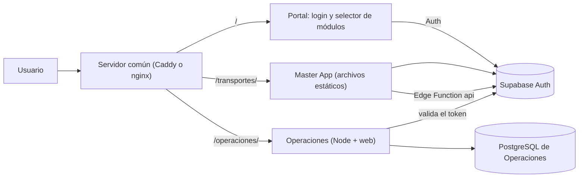

# 08 · Operaciones como módulo e integración con la Master App

Esta guía explica cómo **Operaciones** (este repositorio) y **Transportes** ([`INTRANSIT-GT/Master-App`](https://github.com/INTRANSIT-GT/Master-App)) conviven en **el mismo servidor**, con **los mismos usuarios de Supabase**, y cómo cada usuario abre **el módulo que tiene asignado**.

> Estado: la parte de Operaciones (módulo, acceso por token de Supabase, portal, proxy) está implementada y probada con un Supabase **simulado**. **No se ha probado contra un proyecto Supabase real** ni se ha modificado la Master App. Los cambios que le tocan a la Master App están descritos en la sección 5.

## 1. Cómo queda armado



- **Un solo dominio y una sola sesión.** Las tres partes se sirven desde el mismo origen, así que comparten la sesión de Supabase que guarda `supabase-js` en el navegador (clave `sb-<proyecto>-auth-token`). Entrar una vez sirve para los dos módulos.
- **La Master App no necesita un servidor propio.** Sigue siendo estática y habla con Supabase (Auth + función Edge `api`). Se copia al servidor común en `/transportes/`. GitHub Pages deja de ser necesario para ella, pero no estorba.
- **Operaciones sí necesita servidor y base de datos** (Node + PostgreSQL). Hoy usa su propio PostgreSQL; mover sus datos a Supabase es la fase 2 (sección 7).

## 2. Cómo se decide qué módulo abre cada usuario

La asignación vive en **Supabase**, en el token de cada usuario: `app_metadata.modulos`.

```json
{ "operaciones": "supervisor", "transportes": "ADMIN" }
```

La clave es el módulo y el valor es el **rol dentro de ese módulo**. También se acepta una lista (`["operaciones","transportes"]`): el módulo queda asignado con el rol mínimo (en Operaciones, `consulta`, solo lectura).

| Piezas | Qué hacen con la asignación |
|---|---|
| **Portal** (`/`) | Inicia sesión, lee `modulos` del token y: 0 módulos → aviso; 1 módulo → entra directo; 2 o más → muestra el selector. `?modulo=operaciones` fuerza uno; `?elegir=1` fuerza el selector. |
| **Operaciones** | Valida firma, vigencia, emisor y audiencia del token. Sin `operaciones` en `modulos` responde **403 `MODULO_NO_ASIGNADO`** y muestra «Módulo no asignado». El rol sale del token: `administrador`, `supervisor`, `operador`, `consulta` o `comercial` (otro valor: **403 `ROL_INVALIDO`**). |
| **Transportes** | Ver sección 5: hoy no lee `modulos`. |

Roles de Operaciones (se validan en el servidor): ver `docs/02-funcional.md`. Los roles de Transportes (ADMIN, ENCARGADO, TORRE, LIQUIDACIONES, COMERCIAL, GERENCIA) son independientes y no se traducen automáticamente: cada módulo lee su propia entrada.

**Dónde se asigna:** con `deploy/supabase/asignar-modulos.sql` (se ejecuta a mano en el SQL Editor). Crea `public.asignar_modulo(email, modulo, rol)` y `public.quitar_modulo(email, modulo)`, solo ejecutables con `service_role`. Importante: se usa `app_metadata` y **no** `user_metadata`, porque el segundo lo puede modificar el propio usuario. Los cambios llegan al token en el siguiente inicio de sesión o renovación (hasta 1 hora).

**Usuarios locales de Operaciones.** En el primer acceso se crea una fila en la tabla `users` del módulo (con el UUID de Supabase) porque la bitácora y las relaciones la necesitan. Con acceso compartido: el nombre y el rol se actualizan desde el token en cada acceso; no se crean usuarios ni se cambian roles desde Operaciones (responde `GESTION_EXTERNA`); sí se puede **suspender** a alguien solo en Operaciones (`USUARIO_INACTIVO`).

## 3. Variables de entorno de Operaciones (módulo)

| Variable | Uso |
|---|---|
| `BASE_PATH` | Ruta del módulo en el servidor común. `/operaciones` integrado; vacío si corre solo. |
| `AUTH_MODE` | `local` (login propio, uso independiente) o `sso` (sesión compartida de Supabase). |
| `SUPABASE_URL` | URL del proyecto. Se usa como emisor esperado (`<url>/auth/v1`). |
| `SUPABASE_PUBLISHABLE_KEY` | Clave publicable (pública). El navegador la usa para renovar la sesión. |
| `SUPABASE_JWT_SECRET` | Solo para proyectos con firma por clave compartida (HS256). Si se omite, se validan las claves públicas del proyecto (`/auth/v1/.well-known/jwks.json`). **Es un secreto: nunca va al navegador.** |
| `SUPABASE_STORAGE_KEY` | Opcional. Por defecto `sb-<ref>-auth-token`, donde `<ref>` es el primer tramo del host. |
| `PORTAL_URL` | Adónde vuelve el usuario para elegir módulo (por defecto `/`). |

El navegador solo recibe, por `/operaciones/config.js`, la ruta base, el modo, la URL y la clave publicable. El manifiesto público `/operaciones/api/modulo` describe el módulo (id, entrada, API, roles y de dónde sale la asignación).

## 4. Puesta en marcha en un servidor común

Requisitos: servidor Linux con Docker, dominio con DNS apuntando al servidor, proyecto Supabase con Auth.

1. **Supabase:** ejecuta `deploy/supabase/asignar-modulos.sql` y asigna módulos (ejemplos al final del archivo). Antes de activar el portal, asigna `transportes` a quienes ya usan la Master App: `select public.asignar_modulo(email, 'transportes') from auth.users;`.
2. **Carpetas:** clona este repositorio y la Master App una junto a la otra (`../Master-App`). En la Master App, copia `js/config.example.js` a `js/config.js` (URL y clave publicable).
3. **Variables:** `cp .env.example .env` y completa todo, incluida la sección «Módulo y sesión compartida».
4. **Portal:** `cp deploy/portal/config.example.js deploy/portal/config.js` con la URL y la clave publicable de Supabase. Los módulos que muestra el portal están en `deploy/portal/modulos.json`.
5. **Arranque:** `TRANSPORTES_DIR=../Master-App docker compose -f docker-compose.integrado.yml up -d --build`. Caddy obtiene el certificado HTTPS del dominio indicado en `SITE_ADDRESS`.
6. **Alternativa sin Docker:** `deploy/nginx.conf` es la misma configuración para nginx; Operaciones se ejecuta con `node dist/index.js` y las variables anteriores.
7. **Verificación:** `https://tu-dominio/` (portal) → entrar → debe abrir el módulo asignado. `https://tu-dominio/operaciones/api/modulo` debe responder el manifiesto.

Añadir un tercer módulo: sirve su aplicación bajo `/<modulo>/`, agrégala a `modulos.json` y asigna la clave del módulo en `app_metadata.modulos`.

## 5. Cambios pendientes en la Master App (no realizados)

Se revisó solo su README. Para que **Transportes también respete la asignación** hay que tocar ese repositorio:

1. **Interfaz:** tras iniciar sesión, si `session.user.app_metadata.modulos` no contiene `transportes`, volver al portal (`location.replace('/')`). Es una comodidad, no una barrera.
2. **Función Edge `api` (la barrera real):** rechazar con 403 si el token no incluye `transportes` en `app_metadata.modulos`. Sin esto, cualquier usuario autenticado de Supabase sigue pudiendo llamar a la API de Transportes aunque no tenga el módulo.
3. **Orden seguro:** primero asignar `transportes` a todos los usuarios actuales (paso 1 de la sección 4) y después desplegar los puntos 1 y 2; al revés se bloquearía a los usuarios existentes.
4. **Rutas relativas:** su README indica que ya funciona bajo un subdirectorio, que es lo que necesita `/transportes/`. Verificar el `service-worker` y el `manifest.json` en esa ruta.
5. El README de la Master App aclara que su despliegue **no se ha probado contra un Supabase real**; esa prueba sigue pendiente.

## 6. Pruebas realizadas

| Prueba | Resultado |
|---|---|
| 84 pruebas del servidor: token válido/vencido/firma ajena/emisor ajeno, módulo no asignado, rol inválido, rol por lista, rol que cambia, usuario suspendido, usuarios no gestionables, `config.js` sin secretos, CSP, ruta base, redirecciones, manifiesto | Pasan |
| 10 pruebas de la web (lectura y renovación de la sesión compartida, una sola renovación en llamadas simultáneas) | Pasan |
| Recorrido integrado en navegador con **nginx real** + Supabase simulado (`e2e/integrado/run.sh`, 20 comprobaciones) | Pasa |
| Recorrido original en modo independiente (`e2e/smoke.mjs`) | Pasa |
| SQL de asignación en PostgreSQL local con un esquema `auth` simulado | Funciona; un usuario sin privilegios no puede ejecutarlo |
| Caddy y Docker (`Caddyfile`, `docker-compose.integrado.yml`) | **No probados** (sin Caddy ni servicio Docker en el entorno de desarrollo) |
| Contra un proyecto Supabase real | **No probado** |

Cómo repetir el recorrido integrado: compilar la web, sembrar la base `omnia` y ejecutar `e2e/integrado/run.sh` (requiere nginx y Chromium de Playwright).

## 7. Fases siguientes

1. **Datos de Operaciones en Supabase:** mover las 28 tablas a un esquema `operaciones` del mismo proyecto (las extensiones `pgcrypto` y `btree_gist` están disponibles en Supabase), con `DATABASE_URL` hacia Supabase. Requiere decidir el esquema, la política de acceso (la API de Operaciones usaría una conexión de servidor; las tablas no se exponen por la API pública) y el respaldo.
2. **Asignación por tabla en lugar de token:** si se prefiere administrar módulos desde una pantalla de la Master App, guardar la asignación en una tabla y que un *Auth Hook* de Supabase la copie a `app_metadata.modulos`. El contrato con los módulos no cambia.
3. **Barrera en Transportes** (sección 5).
4. **Recuperación de contraseña** (Supabase la ofrece; falta una pantalla en el portal).
